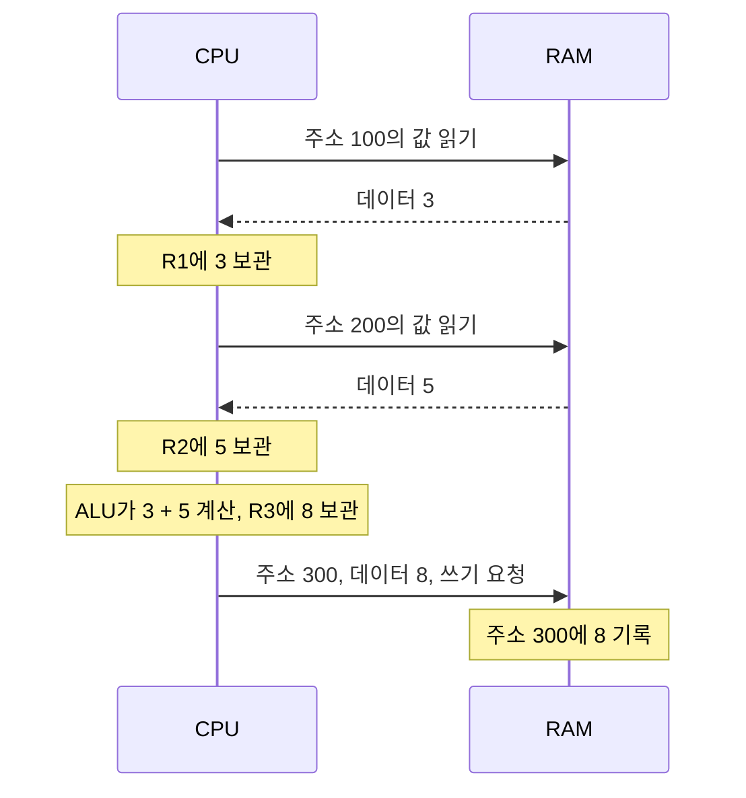
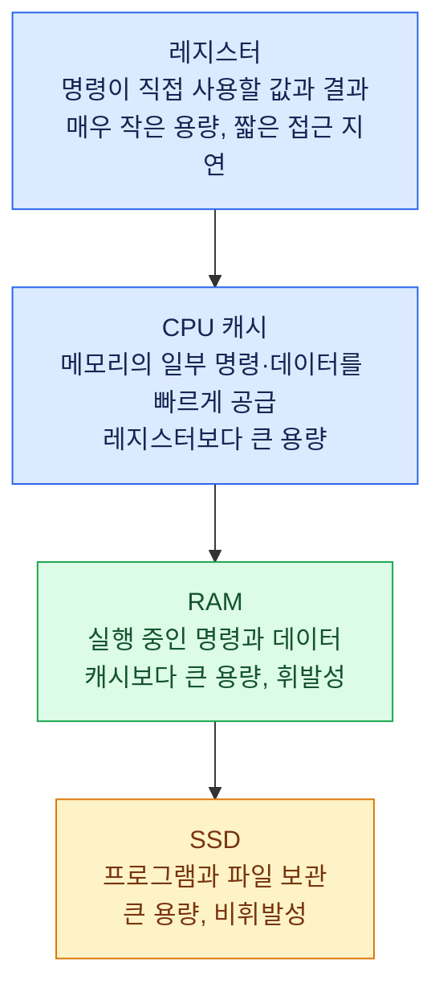
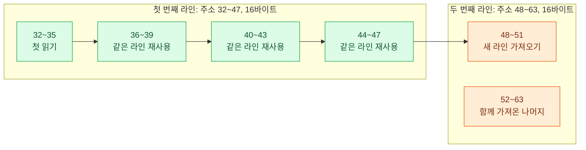

# 컴퓨터 구성과 메모리 계층 — 2026-11-03 복습 정리

- 범위: ARCH-03·ARCH-06, 연결 설명 ARCH-04·ARCH-07.
- 이 문서는 AI가 수업과 확인한 원문을 바탕으로 정리한 복습 자료다. 읽었다는 사실을 학습자의 이해 증거로 취급하지 않는다.
- 실제 답변과 교정 과정: [세션 기록](../../sessions/2026-11-03-01.md), [컴퓨터 구성 노트](../ARCH-03-computer-components.md), [메모리 계층 노트](../ARCH-06-memory-hierarchy.md).
- 사용법: 아래 복습 질문에서 하나를 골라 자료를 보지 않고 먼저 설명한다. 이후 정리본과 비교하고, 수정한 설명을 남긴다. 수업 중 질문은 한 번에 하나씩 진행한다.

## 1. 구성 요소의 역할

| 구성 요소 | 핵심 역할 | 구분할 점 |
|---|---|---|
| CPU | 명령을 읽고 해석하여 실행 | 제어 장치가 동작을 제어하고 ALU가 산술·논리 연산을 수행 |
| 레지스터 | CPU가 직접 사용할 값과 연산 결과 등을 보관 | 값을 보관하는 역할과 ALU의 연산 역할을 구분 |
| CPU 캐시 | 메모리의 명령·데이터 일부를 가까운 곳에서 빠르게 공급 | 일반적으로 하드웨어가 접근에 따라 관리하며, 모든 데이터가 항상 캐시에 있는 것은 아님 |
| RAM | 실행 중 필요한 명령과 데이터를 보관 | 일반적인 주기억장치는 휘발성이며, 중요한 편집 데이터도 작업 중 RAM을 사용 |
| SSD | 프로그램과 파일을 전원 없이도 보관 | 프로그램을 실행할 때 전체를 반드시 한꺼번에 RAM에 올리는 것은 아님 |
| 버스 | 구성 요소 사이에서 주소·데이터·제어 정보를 전달 | 여기서는 논리적 역할을 구분하며, 실제 배선·연결 규약은 구현에 따라 다름 |

캐시와 레지스터는 역할이 다르다. 캐시는 메모리 접근을 빠르게 하는 데 쓰이고, 레지스터는 명령이 직접 사용할 값 등을 보관한다.

## 2. 명령과 데이터, 읽기와 쓰기

숫자 3과 5는 데이터다. 두 값을 더할지 곱할지는 프로그램의 명령이 정한다. CPU가 그 명령을 읽고 해석하여 실행한다. RAM에 보내는 읽기·쓰기 요청과 CPU가 수행하는 덧셈 명령을 구분한다.

RAM 주소 100에 3, 주소 200에 5가 있고, 덧셈 결과를 주소 300에 기록하는 교육용 예시:

```text
LOAD  R1, [100]    : 주소 100의 값을 R1으로 읽기
LOAD  R2, [200]    : 주소 200의 값을 R2로 읽기
ADD   R3, R1, R2  : ALU로 더하고 결과 8을 R3에 보관
STORE [300], R3    : R3의 값 8을 주소 300에 쓰기
```

실제 ISA의 문법이 아닌 의사 명령이며 캐시·메모리 컨트롤러의 세부 동작은 생략했다. CPU는 각 명령의 읽기→해석→실행을 반복한다. 프로그램 카운터 등 상세 목표는 ARCH-04에 남아 있다.

### 그림: 요청과 데이터가 오가는 순서

아래는 위 예시의 데이터 읽기·연산·쓰기에 집중한 순서도다. 각 명령 자체를 가져오는 과정, 캐시·메모리 컨트롤러, 규약별 응답은 생략했다.



| 구분 | 요청자가 보내는 핵심 정보 | 결과 |
|---|---|---|
| RAM 읽기 | 주소 100 + 읽기 요청 | RAM 쪽에서 해당 위치의 값 3을 전달 |
| RAM 쓰기 | 주소 300 + 데이터 8 + 쓰기 요청 | 지정한 위치에 값 8을 기록 |

읽기 전에는 해당 값이 무엇인지 몰라도 된다. 위치를 지정할 주소는 필요하다. 쓰기에서도 목적 주소는 요청자가 지정하며, RAM이 저장할 주소를 골라 응답하는 흐름이 아니다.

쓰기 응답은 연결 규약에 따라 다르다. 예를 들어 AXI에는 쓰기 거래의 상태를 알리는 별도 응답이 있다. 앞의 교육용 예시에서 생략했다고 응답이 항상 없다고 결론 내리지 않는다. AXI 응답과 실제 RAM 칩의 인터페이스를 동일시하지 않는다.

## 3. 메모리 계층을 함께 사용하는 이유

가장 빠른 저장 공간 하나로 큰 용량·낮은 비용·짧은 접근 지연·전원 없이 보관하는 특성을 모두 만족시키기 어렵다. 큰 저장 공간에 많은 데이터를 두고, 그중 현재 사용하는 일부를 작고 빠른 공간에서 활용한다.

### 그림: 계층별 역할과 절충

위에서 아래로 갈수록 일반적으로 용량이 커지고 접근 지연이 길어진다. 연결선은 계층의 순서를 나타낸다. 실제 값의 이동은 실행하는 명령과 접근 상황에 따라 결정된다.



일반적으로 CPU 캐시에는 SRAM, 주기억장치에는 DRAM을 사용한다. SRAM은 같은 용량을 만드는 데 회로 면적과 비용이 더 많이 필요하다. 같은 기술로 저장 공간을 크게 늘리면 신호 이동 거리 등도 증가하므로 작은 캐시의 접근 지연을 그대로 유지한다고 가정할 수 없다.

같은 데이터가 여러 계층에 복사되어 사용될 수 있다. 사진 원본을 SSD에 보관하면서 편집할 데이터를 RAM에 불러오고, 접근한 일부 데이터는 캐시에, 연산할 값과 결과는 레지스터에 보관할 수 있다. 모든 데이터가 항상 모든 계층에 동시에 있다는 뜻은 아니다.

레지스터의 값만 바꿔도 RAM이나 SSD의 파일이 자동으로 바뀌지는 않는다. RAM에 기록하는 동작과 파일을 저장하는 동작도 구분한다. 파일 저장의 실제 내구성 보장·버퍼 반영 시점은 오늘 검증한 범위를 넘는다.

## 4. 시간 지역성과 공간 지역성

| 개념 | 뜻 | 오늘의 예시 |
|---|---|---|
| 시간 지역성 | 최근 접근한 위치에 가까운 미래에 다시 접근하는 경향 | 같은 네 배열 요소를 여러 차례 반복해서 읽기 |
| 공간 지역성 | 어떤 위치에 접근한 뒤 가까운 위치에도 접근하는 경향 | 연속된 네 배열 요소를 순서대로 읽기 |

캐시는 보통 값 하나씩이 아니라 캐시 라인이라는 블록 단위로 가져온다. 공간 지역성이 있으면 함께 가져온 나머지 데이터를 후속 접근에서 활용할 수 있다. 데이터의 의미상 관련성이 직접적인 동작 원리는 아니다.

교육용 조건: 16바이트 라인, 주소 0부터 16바이트씩 경계, 빈 캐시, 요청한 라인만 가져오기, 중간 교체와 미리 읽기 없음.

- 32→36→40→44→48: 32~47을 가져온 뒤 36·40·44를 같은 라인에서 읽고, 48에서 다음 라인을 가져온다. 총 2회다.
- 32→48→64→80→96을 각각 한 번만 읽기: 서로 다른 라인 5개가 필요하다. 이 데이터 접근열에서는 함께 가져온 나머지 부분을 활용하지 못한다.

### 그림: 한 라인에서 함께 가져오는 주소

아래 그림에서는 각 값을 4바이트로 표현했다. `32 → 36 → 40 → 44 → 48` 순서로 읽을 때 초록색 네 칸은 첫 번째 라인에 함께 들어오고, 주황색 칸은 다음 라인이 필요하다. 색과 함께 라인 경계·주소·첫 읽기/재사용 표기를 확인한다.



그림의 화살표는 읽는 순서다. 캐시로 가져오는 단위는 개별 칸이 아니라 각 칸이 속한 라인 전체다.

16바이트는 계산을 위한 예시이며 실제 모든 CPU의 고정 라인 크기가 아니다. 지역성은 경향이며, 모든 접근의 캐시 적중이나 성능 향상을 보장하지 않는다.

## 5. 오늘 고친 핵심 표현

- “값 3을 읽기 요청” → “주소 100의 값을 읽기 요청”.
- “RAM이 저장할 주소를 응답” → “요청자가 주소·데이터·쓰기를 보내고, 지정한 위치에 기록”.
- “레지스터에서 연산” → “레지스터에 값을 보관하고 ALU가 연산”.
- “가까운 데이터는 의미상 관련되어 캐시가 유리” → “라인 단위로 가져온 가까운 데이터를 실제로 활용하면 유리”.
- “데이터마다 저장할 계층 하나를 선택” → “같은 데이터가 여러 계층에서 사용될 수 있으며 각 계층의 특성을 조합”.

위 문장은 AI가 다듬은 표현이다. 당시 학습자 답변과 교정 뒤 실제 답변은 원본 노트에서 구분해 확인한다.

## 6. 복습 질문

문서에 모아 둔 후보이며 오늘 새로 질문하거나 답변을 받은 기록은 아니다. 실제 복습은 하나씩 진행하고, 이후에는 조건을 바꾼다.

1. 주소의 값이 무엇인지 모르는 CPU도 그 값을 읽을 수 있는 이유는 무엇인가?
2. 계산 결과를 RAM에 기록했지만 파일을 저장하지 않았다면 SSD 원본 파일은 어떻게 되는가?
3. 작은 표의 같은 행을 반복해서 읽는 경우와 큰 배열을 한 번 순차로 읽는 경우, 각각 어떤 지역성을 기대할 수 있는가?
4. 캐시를 크게 늘리면 비용 외에 접근 지연 측면에서 무엇을 고려해야 하는가?

## 7. 확인한 원문과 남은 목표

확인일: 2026-11-03(Asia/Seoul). 웹 도구로 직접 읽은 범위를 정리했다. 실제 성능 실험은 하지 않았다.

- [Chris Terman, L09: Instruction Set Architectures](https://computationstructures.org/lectures/isa/isa.html): 폰 노이만 모델, 레지스터·ALU, 주소에 따른 메모리 접근과 명령 실행 루프.
- [Chris Terman, L14: The Memory Hierarchy](https://computationstructures.org/lectures/caches/caches.html): 메모리 기술의 용량·지연 절충, locality of reference, 캐시와 block size.
- [Arm, Introduction to AMBA AXI4](https://developer.arm.com/-/media/Arm%20Developer%20Community/PDF/Learn%20the%20Architecture/102202_0100_01_Introduction_to_AMBA_AXI.pdf), 102202 Issue 01(2020), §4.4·§5.1·§5.5·§5.6: 쓰기 응답 사례와 계층별 응답 차이. 모든 CPU·RAM의 공통 구현으로 일반화하지 않는다.

남은 목표는 교정 후 전체 실행 흐름의 재설명, 큰 캐시의 면적·지연 절충 재설명, 명령 실행의 세부 목표, 캐시 교체·쓰기 정책, 이후 세션의 간격 복습이다. 현재 상태와 후보 일정은 [진도표](../../tracking/progress.md)와 [복습 대기열](../../review/queue.md)을 따른다.
