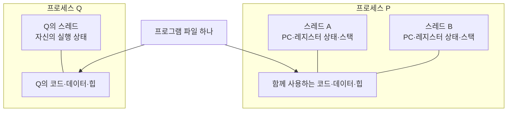
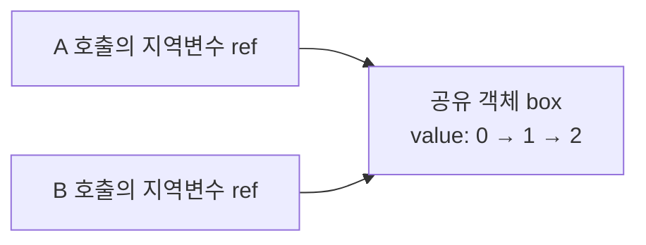

# 프로그램·프로세스·스레드 — 2026-11-03~04 복습 정리

- 범위: OS-02. 문맥 교환·실행 상태는 OS-03의 연결 설명이다.
- [세션 기록](../../sessions/2026-11-03-02.md), [실제 답변 원문 15건](../../sessions/2026-11-03-02-answers.md), [주제 노트](../OS-02-programs-processes-threads.md).
- AI가 실제 수업과 확인한 원문을 바탕으로 정리했다. 읽기·수정안 확인을 학습자의 독립 설명 증거로 취급하지 않는다.
- 복습은 질문 하나에 먼저 답한 뒤 정리본과 비교한다.

## 1. 세 용어의 관계

| 구분 | 의미 | 교육용 텍스트 편집기 예시 |
|---|---|---|
| 프로그램 | 저장된 명령과 데이터 | SSD의 실행파일 |
| 프로세스 | 실행한 인스턴스와 그 실행에 필요한 자원의 관리 단위 | 편집기를 실행해 만든 인스턴스 |
| 스레드 | 프로세스 안의 실행 흐름 | 입력 처리와 자동 저장을 담당하는 두 실행 흐름 |

프로그램 하나에서 여러 프로세스가 만들어질 수 있고, 프로세스 하나에 여러 스레드가 있을 수 있다. 실제 제품의 프로세스·스레드 구성은 구현에 따라 달라진다.



그림은 프로그램과 실행 인스턴스·실행 흐름의 관계를 표시한다. 두 프로세스 사이에 명시적 공유를 설정하지 않은 기본 모델이며, 코드 페이지의 물리적 공유 여부까지 나타내는 그림은 아니다.

## 2. 함께 사용하는 것과 따로 유지하는 것

| 같은 프로세스의 스레드들이 함께 사용할 수 있는 것 | 스레드별로 보존하는 것 |
|---|---|
| 코드·전역 데이터·힙 객체, 프로세스의 열린 파일 등 | PC 값·레지스터 상태·스택의 함수 호출 기록 |

PC는 실행을 이어갈 명령 위치를 나타낸다. 같은 함수의 같은 명령 위치에 있어 PC의 숫자가 같더라도, 어느 스레드의 실행 상태인지 따로 관리한다. 두 프로세스에 스레드가 각각 두 개면 PC 상태는 네 개다.

한 코어에서 번갈아 실행할 때는 중단하는 흐름의 상태를 보존하고 재개할 흐름의 상태를 복원한다. 예를 들어 A의 R1=5를 저장한 뒤 B가 같은 물리적 레지스터를 30으로 사용했어도, A 재개 시 자신의 값 5를 복원한다. 물리적 레지스터 위치를 각 실행에 영구 배정한다는 뜻은 아니다.

스레드별 스택도 같은 프로세스의 주소 공간 안에 있다. 별도 함수 호출 기록을 유지하는 것과 프로세스 간 메모리 보호는 구분한다. 구체적인 다른 스레드의 스택 접근은 이번 학습의 독립 확인 범위를 넘는다.

## 3. 코드가 같아도 변수의 소속에 따라 결과가 달라진다

다음은 언어 중립 의사코드이며, A가 끝난 뒤 B를 실행하는 순서다. 동시에 증가시키는 경쟁 상태를 실험한 것이 아니다.

```text
프로세스의 전역변수 total = 0

함수 work():
    지역변수 partial = 0
    partial = partial + 1
    total = total + 1
    출력(partial, total)
```

| 실행 조건 | A 또는 P의 출력 | B 또는 Q의 출력 | 이유 |
|---|---|---|---|
| 같은 프로세스의 스레드 A→B | (1, 1) | (1, 2) | partial은 각 호출의 지역변수, total은 같은 프로세스의 변수 |
| 명시적 공유가 없는 프로세스 P→Q, 각 total=0으로 시작 | (1, 1) | (1, 1) | 각 프로세스가 자신의 total을 관리 |

교육용 모델에서는 지역변수를 각 호출의 스택 프레임에 연결해 설명한다. 실제 값이 항상 RAM 스택에 존재하는 것은 아니며, 구현·최적화에 따라 레지스터에 보관되거나 제거될 수도 있다. 변수의 소속과 물리적 저장 위치를 구분한다.

## 4. 지역 참조변수와 공유 객체

지역변수라는 사실만으로 그 변수가 가리키는 객체까지 독립적인 것은 아니다.



이 그림은 두 ref가 같은 객체를 가리키며 A 완료 후 B 실행을 가정한다. 객체를 복제하지 않고 참조를 복사한 뒤 각 호출이 value를 1 증가시키므로 B는 2를 출력한다. Java 매개변수 전달 전체나 동시 실행의 안전성을 검증한 예시는 아니다.

## 5. 동시성과 병렬성

- 동시성: 여러 작업의 진행 기간이 겹치는 것. 한 코어에서 번갈아 실행해도 가능하다.
- 병렬성: 여러 실행 흐름을 실제로 동시에 실행하는 것. 여러 코어 활용이 대표적인 예다.

| 한 코어에서 번갈아 실행하는 모델 | 기대할 수 있는 점 |
|---|---|
| A는 네트워크 응답 대기, B는 독립적으로 실행 준비 | A가 기다리는 동안 B를 실행 가능 |
| I/O 대기 없이 계산 100개를 두 스레드가 50개씩 분담 | 총 계산량은 그대로이므로 두 스레드라는 이유로 시간 절반을 보장하지 않음 |

문맥 교환·관리 비용도 있다. 예시는 실제 시간 측정이 아니며 실제 CPU의 모든 명령 처리 방식을 한 번에 한 작업으로 일반화하지 않는다.

## 6. 교육용 모범 답변

아래는 AI가 작성한 참고 답안이며 학습자 답변 원문과 구분한다.

텍스트 편집기 실행파일은 프로그램이고, 이를 실행한 인스턴스가 프로세스다. 프로세스 하나에 입력 처리와 자동 저장 스레드를 둔다고 가정하면, 두 스레드는 문서 데이터와 프로세스 자원을 함께 사용할 수 있다. 각 스레드는 PC·레지스터 상태·스택을 따로 유지해 서로 다른 명령과 함수 호출을 이어간다. 한 코어에서도 자동 저장이 I/O를 기다리는 동안 준비된 입력 처리를 실행할 수 있다. 공유 문서를 읽고 수정하는 순서 조정은 이후 동기화에서 다룬다.

메신저·다운로더·이미지 편집기도 관계를 설명할 교육용 예시로 사용할 수 있다. 실제 앱의 구현 사실이나 본인의 프로젝트 경험으로 단정하지 않는다.

## 7. 복습과 남은 목표

질문 후보이며 새로운 답변을 받은 기록은 아니다. 실제 학습에서는 하나씩 묻는다.

1. 같은 프로세스의 두 스레드가 같은 함수의 같은 줄에 있어 PC 숫자가 같다면, PC 상태도 하나로 합쳐 관리할 수 있을까?
2. 실행파일 하나에서 만든 두 프로세스의 전역변수와 열린 파일 등 자원은 어떤 기준으로 설명해야 할까?
3. 직접 고른 프로그램 하나로 프로그램·프로세스·스레드 관계와 공유 자원·개별 실행 상태를 빠짐없이 설명할 수 있을까?

OS-02는 N2로 기록했다. 자원 소유를 포함한 통합 재설명과 간격 복습이 남아 있다. OS-03의 정식 상태 전이·선점·비용 등은 N1에서 이어간다. 진행 단계는 [진도표](../../tracking/progress.md)만 기준으로 한다.

## 8. 확인한 원문

- [OSTEP Chapter 4: The Abstraction: The Process](https://pages.cs.wisc.edu/~remzi/OSTEP/cpu-intro.pdf), Version 1.10, 도입·§4.1. 2026-11-03 확인.
- [OSTEP Chapter 26: Concurrency: An Introduction](https://pages.cs.wisc.edu/~remzi/OSTEP/threads-intro.pdf), Version 1.10, 도입·Figure 26.1·§26.1. 2026-11-03 확인, 11-04 재확인.
- [GCC 온라인 매뉴얼 §3.11](https://gcc.gnu.org/onlinedocs/gcc/Debugging-Options.html), 최적화와 디버깅 설명. 2026-11-04 확인. 설치 버전·컴파일 결과·실행 성능 실험은 확인하지 않았다.
